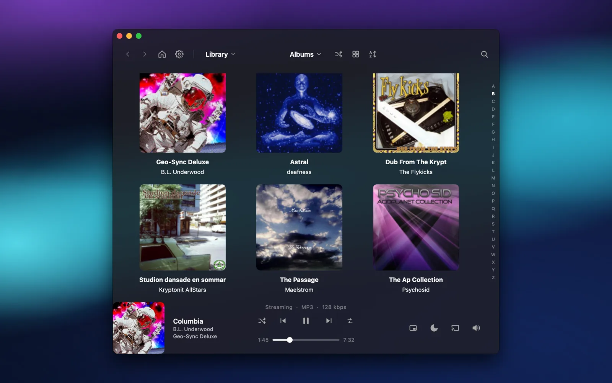
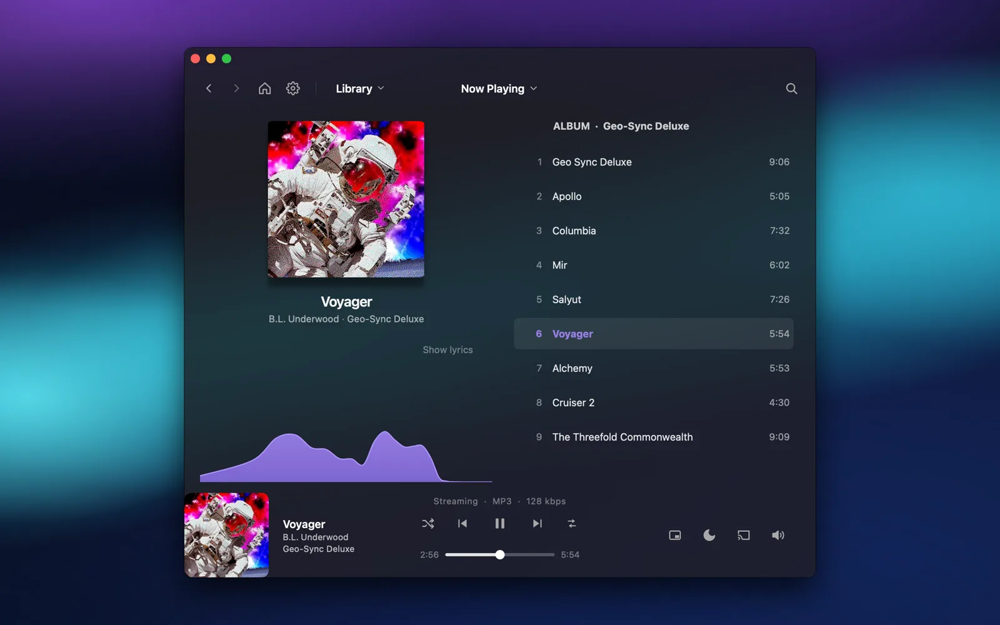
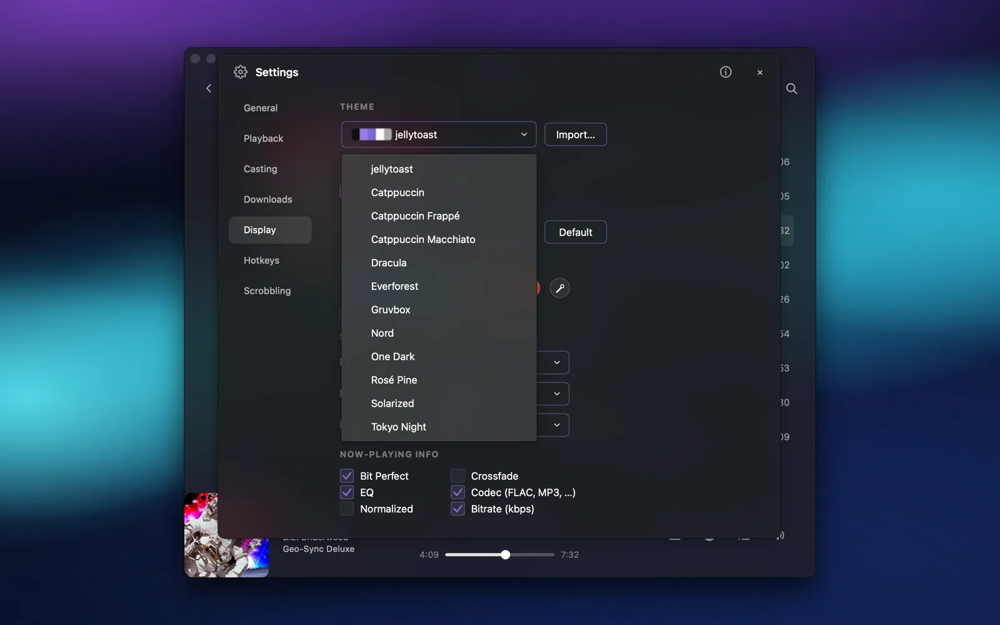
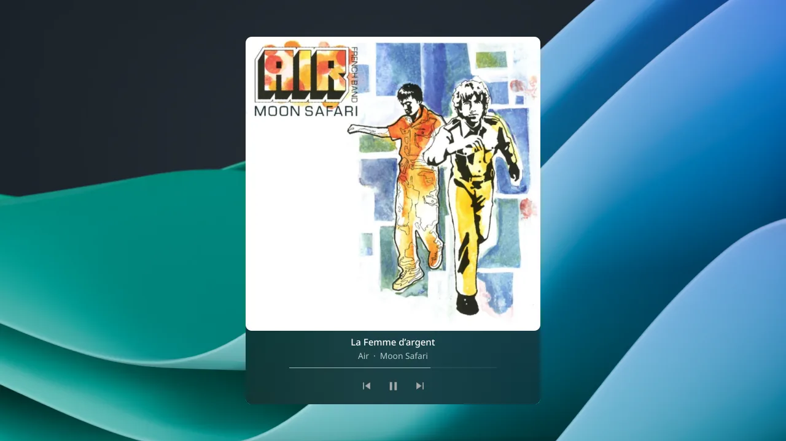

<h1 align="center">jellytoast</h1>

<p align="center">
  A music player for <a href="https://jellyfin.org/">Jellyfin</a> and
  <a href="https://www.navidrome.org/">Navidrome</a> servers, on your desktop and your Linux phone —<br>
  bit-perfect playback, casting, and offline downloads.
</p>

<p align="center">
  <a href="https://github.com/wolfgangwarehaus/jellytoast/actions/workflows/ci.yml"></a>
  <a href="LICENSE"></a>
</p>

## Features

- **For your self-hosted music** — Jellyfin and Navidrome, with multiple libraries. Type your server's address and sign in; jellytoast works out which kind it is.
- **Made for phones too** — on Plasma Mobile and Phosh it opens a touch-first interface: swipe gestures, lyrics, a queue you can drag around, downloads and casting. Close it mid-song and the music keeps going. Installs on [Nura / postmarketOS and Arch Linux ARM](docs/linux-phones.md).
- **Bit-perfect audio** — FLAC / ALAC / OPUS / DSD playback via [mpv](https://mpv.io/), or EQ, crossfade and volume normalization when you want them.
- **Cast anywhere** — send music to Chromecast and Google speaker groups, AirPlay 2, Sonos, or DLNA. Groups play on through Wi-Fi hiccups, and each speaker gets its own volume back when you stop. Local relay for offline or Tailscale casting.
- **Offline mode** — cache albums, playlists, or your whole library for offline playback.
- **Floating mini player** — compact and album-art views.
- **Desktop features** — media keys, a tray icon, optional notifications, and a start-at-login option.
- **Frosted glass & theming** — background blur on KDE, macOS, and Windows, plus a full theme picker: light/dark, built-in color presets (Catppuccin, Dracula, Nord, Gruvbox, …), import any base16 scheme, or follow your system accent (and your pywal wallpaper palette on Linux).
- **Playlists your way** — add songs, albums and whole playlists to your server's playlists, rename or delete them, or build smart playlists from rules.
- **And more** — synced lyrics, an audio visualizer, smart shuffle, internet radio, a sleep timer, Last.fm and ListenBrainz scrobbling, and tag editing (Jellyfin). In English and Spanish.

## Screenshots

<table>
  <tr>
    <td width="50%"><a href="docs/screenshots/webp/library.webp"></a><br><sub><b>Library</b> — browse albums, artists, and songs</sub></td>
    <td width="50%"><a href="docs/screenshots/webp/now-playing.webp"></a><br><sub><b>Now playing</b> — synced lyrics + audio visualizer</sub></td>
  </tr>
  <tr>
    <td width="50%"><a href="docs/screenshots/webp/theme-picker.webp"></a><br><sub><b>Theming</b> — presets, base16 import, follow system accent</sub></td>
    <td width="50%"><a href="docs/screenshots/webp/mini-expanded.webp"></a><br><sub><b>Mini player</b> — compact and album-art views</sub></td>
  </tr>
</table>

## Install

Latest builds are on [**Releases**][rel].

- **Linux**
  - [AppImage][dl-appimage]
  - [.deb][dl-deb]
  - [Flatpak][dl-flatpak], or from our [Flatpak repo](https://wolfgangwarehaus.com/flatpak/) so it updates
    like any other app: `flatpak install --user https://wolfgangwarehaus.com/flatpak/io.github.wolfgangwarehaus.jellytoast.flatpakref`
  - [AUR][aur] — `yay -S jellytoast`
- **Linux phones** (Plasma Mobile, Phosh) — Nura / postmarketOS and Arch Linux ARM:
  see [Linux phones](docs/linux-phones.md)
- **macOS**
  - [App Store][mas]
  - [.dmg][dl-dmg] *(Apple Silicon, macOS 15+)*
- **Windows**
  - [Microsoft Store][store]
  - [.exe][dl-exe] *(one installer — x64 + ARM64)*
  - `winget install jellytoast`
- **Any OS**
  - `pipx install jellytoast` *(needs libmpv installed, like from-source)*

**From source** (Python 3.11+, Qt 6, libmpv):

```bash
git clone https://github.com/wolfgangwarehaus/jellytoast.git
cd jellytoast && pip install -e .
jellytoast
```

Want to contribute? [`CONTRIBUTING.md`](.github/CONTRIBUTING.md) has the dev setup, the architecture, and the conventions this codebase follows.

[rel]: https://github.com/wolfgangwarehaus/jellytoast/releases/latest
[store]: https://apps.microsoft.com/detail/9PNLTPXGHN79
[mas]: https://apps.apple.com/app/id6784370624
[aur]: https://aur.archlinux.org/packages/jellytoast
<!-- Direct-download aliases: versionless names the release workflow
     attaches to every release, so /latest/download/ links never break. -->
[dl-appimage]: https://github.com/wolfgangwarehaus/jellytoast/releases/latest/download/jellytoast-x86_64.AppImage
[dl-deb]: https://github.com/wolfgangwarehaus/jellytoast/releases/latest/download/jellytoast-amd64.deb
[dl-flatpak]: https://github.com/wolfgangwarehaus/jellytoast/releases/latest/download/jellytoast.flatpak
[dl-dmg]: https://github.com/wolfgangwarehaus/jellytoast/releases/latest/download/jellytoast-macos.dmg
[dl-exe]: https://github.com/wolfgangwarehaus/jellytoast/releases/latest/download/jellytoast-windows-setup.exe

## Documentation

- [`user_guide.md`](docs/user_guide.md) — how to use every feature
- [`CONTRIBUTING.md`](.github/CONTRIBUTING.md) — dev setup, architecture & conventions
- [`SPEC.md`](docs/SPEC.md) — what the app actually does today
- [`SECURITY.md`](.github/SECURITY.md) — how to report a vulnerability
- [`CHANGELOG.md`](CHANGELOG.md) — what changed in each release

## License

GPL-2.0-or-later, with an App Store distribution exception so store
builds stay unambiguously legal. See [`LICENSE`](LICENSE) and
[`LICENSING.md`](LICENSING.md).

## Support

Want to leave a tip? [Ko-fi ☕](https://ko-fi.com/wolfgangwarehaus)
